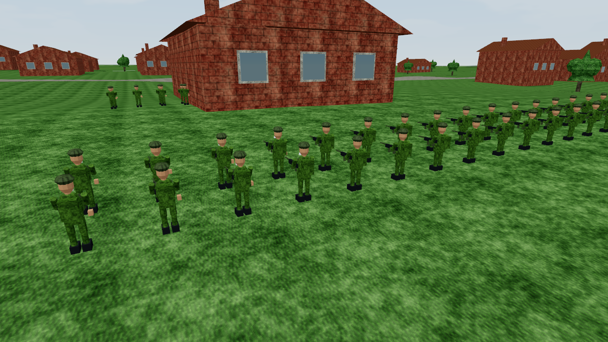
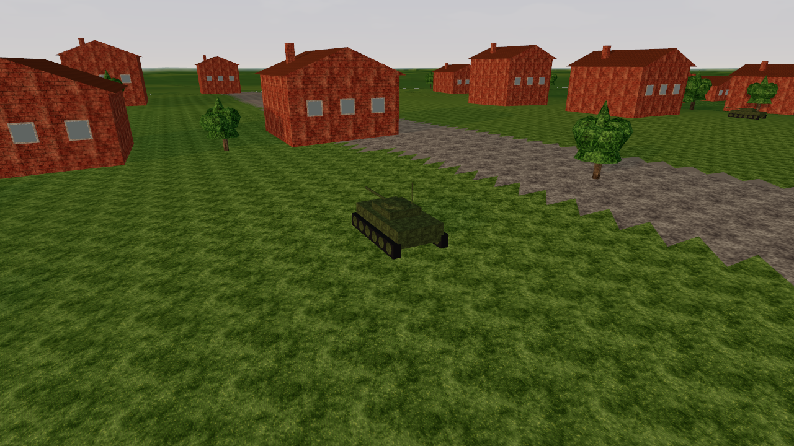
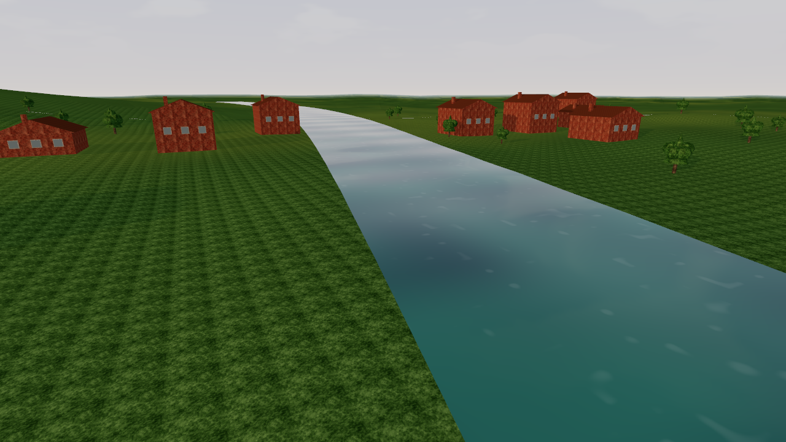

# GRAY ZONE: 1989 — v0.0.23

[Завантажити Windows x64 ZIP](https://github.com/zaveruhaoleg2000-droid/1st/raw/refs/heads/release/graphics-v023/GRAY_ZONE_1989_RTX3050TI_WIN_X64.zip)

Повністю розпакуйте ZIP, запустіть **PLAY_HIGH.bat** для високої якості або **PLAY_CPU.bat** для CPU fallback. Профіль орієнтований на RTX 3050 Ti 4 ГБ; швидкодія на фізичній карті ще не виміряна.

Об'ємні бійці зі зброєю й спорядженням; декоративні танк, БТР та вантажівка; детальні будинки й дерева; текстури, тіні, MSAA, вода й погода.

Перевірено Linux Vulkan 26/26 із synchronization validation, CPU Debug/Release 25/25; Windows CPU/Vulkan по 23/23 під Wine. Windows native Vulkan подав шість текстурованих кадрів під Wine/Mesa без CPU fallback. Фізична RTX 3050 Ti та Windows 11 ще не тестувалися. Техніка декоративна; нової AI/фізики немає.

Це гілка публікації артефактів. Вихідний код міститься у **GRAY_ZONE_1989_v023_SOURCE.zip**; версію вихідного коміту записано у SOURCE_COMMIT.txt. SHA256 і звіти перевірок входять у пакет.

Справжні native Vulkan кадри 1280×720 через програмний Mesa Lavapipe:

