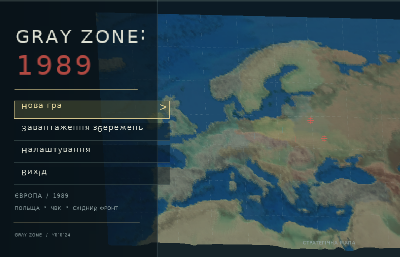
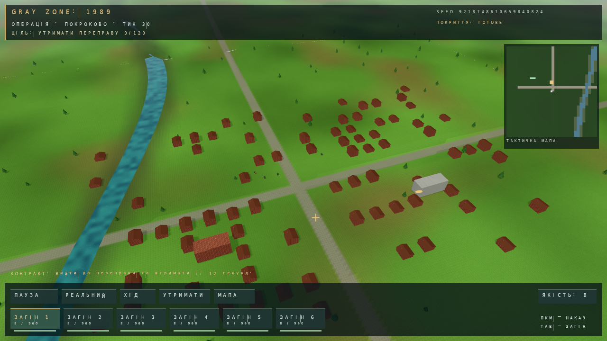
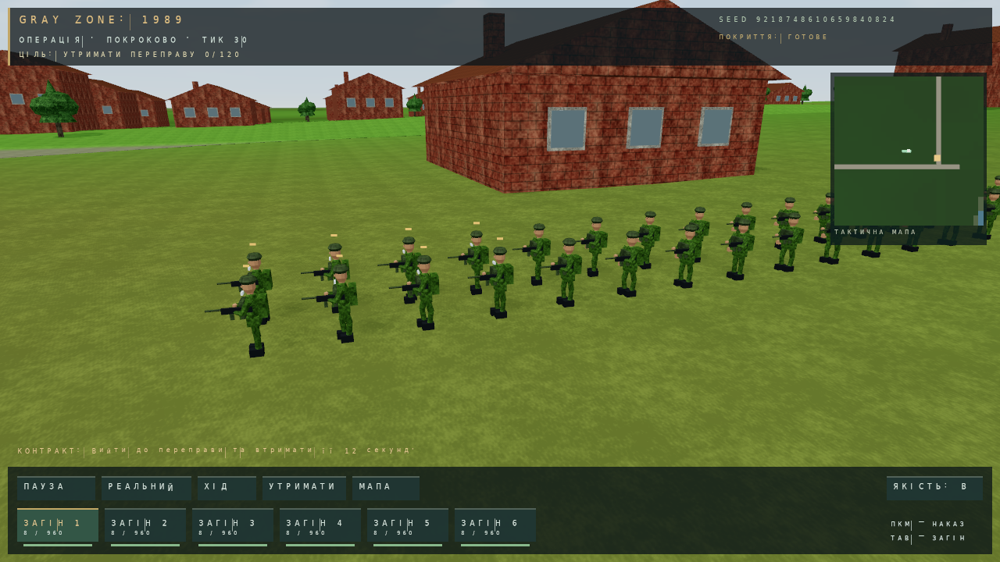
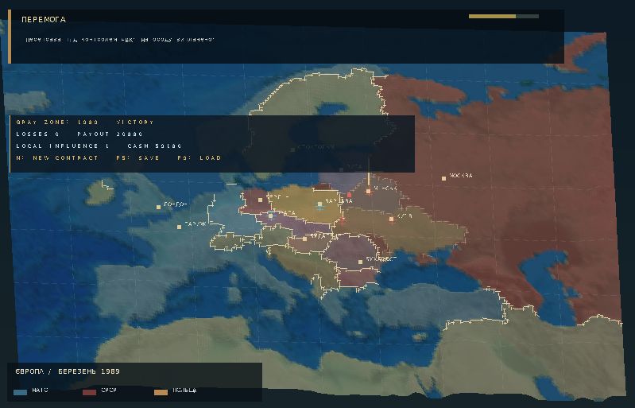
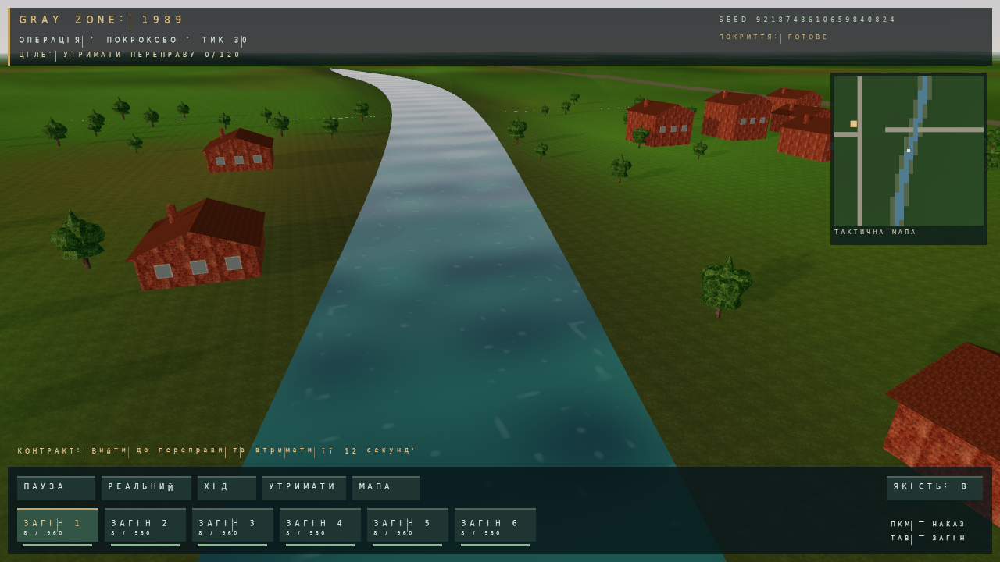
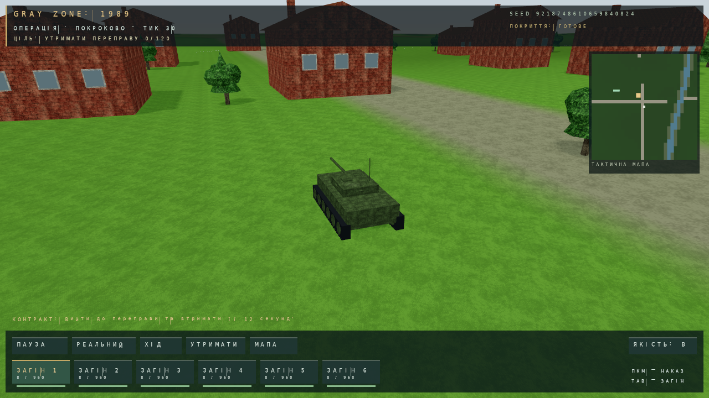

# GRAY ZONE: 1989 — огляд v0.0.24

Це робочий прототип альтернативно-історичної тактичної стратегії про ЧВК у Східній Європі 1989 року. Його основний цикл: обрати сценарій → визначити чисельність → оплатити висадку → керувати загонами → завершити контракт → отримати нагороду/втрати → зберегти кампанію або взяти наступний контракт.

Огляд складено за актуальним кодом і виконаними runtime тестами. Зображення нижче — справжні кадри рушія. Тактичні кадри: native Vulkan, програмний Mesa Lavapipe, 1280×720, macro 4096px, MSAA 4x, synchronization validation. Меню й стратегічна карта: CPU runtime Windows EXE під Wine, внутрішня роздільність 799×513. Це не вимірювання фізичної RTX 3050 Ti й не концепт-арт.

## Початок гри й сценарії

Головне меню має нову гру, слоти збережень і базові налаштування. Доступні три сюжетні сценарії: Варшавський коридор, Лінія Прип'яті та Дунайський архів. Вони відрізняються текстами, початковими коштами, подіями й репутаційними наслідками. У v0.0.24 також задають різні профілі генератора рельєфу.

Бойовий шаблон поки спільний: контроль визначеної зони, яка в інтерфейсі називається переправою. Сюжетні задачі про ретранслятор/архів ще не стали окремими механіками місій. Написи про фракції/ЧВК в меню не означають, що всі вони мають окремі playable campaigns.

## Тактика та інтерфейс

Верхня панель показує ціль, режим і тики. Нижня — керування паузою, ходом, утриманням і мапою; картки своїх загонів показують кількість живих, запас боєприпасів та індикатор здоров'я. Праворуч є мінікарта своїх підрозділів і цілі. Клік по картці обирає загін, ПКМ задає точку руху; Tab циклічно перемикає загони. Натискання мінікарти переносить фокус камери.

У загоні до восьми бійців. Рух — до точки з простим строєм і швидкістю до 2 м/с. Утримання позиції скасовує рух, але дозволяє автоматичний вогонь. Вибір мишею тепер використовує актуальну native камеру, незалежно від останнього CPU кадру.

## Три режими й стрільба

| Режим | Керування | Роль |
| --- | --- | --- |
| Тактика | 1 | Загальний огляд і накази загонам |
| Близький вид за бійцем | 2 | Камера біля командира, рух керованого бійця; не ручна FPS стрільба |
| Стратегічна карта | 3 | Карта, кампанія й автоматичне просування симуляції |

Симуляція має фіксований крок 0,1 с. У покроковому режимі Enter або кнопка «ХІД» виконує 50 тиків — п'ять секунд ігрового часу. T/кнопка режиму перемикає реальний час, Space/кнопка паузи зупиняє його.

Вогонь автоматичний. Раз на секунду симуляція знаходить найближчий ворожий загін у межах видимості, до двох бійців загону витрачають по одному патрону, а ціль отримує шкоду. Базовий запас — 120 на бійця; шкода 13 на близькій дистанції до 80 м або 8 далі. Це проста детермінована модель. Обхід будинків, стрільба з урахуванням стін/рельєфу, перезарядка, придушення та ролі бійців ще не реалізовані.

## Контракт, економіка та результат

Висадка коштує 125 за бійця. Сила загону: 24/48/72/96. Ворогів при висадці — 75% від своїх, із мінімумом 16.

| Свої бійці | Вартість | Базова нагорода без втрат |
| ---: | ---: | ---: |
| 24 | 3 000 | 19 440 |
| 48 | 6 000 | 20 880 |
| 72 | 9 000 | 22 320 |
| 96 | 12 000 | 23 760 |

За кожного втраченого бійця нагорода зменшується на 110, із мінімальною виплатою 2500. При перемозі змінюються гроші, репутація та локальний вплив сценарію. Це локальний прогрес, а не симуляція перекроювання державних кордонів.

Для перемоги потрібно втримати зону радіусом 125 м протягом 120 тиків: мінімум чотири своїх, перевага над ворогом у зоні, уже відбулася стрільба й збережено понад чверть початкової сили. Альтернатива — знищити всіх ворогів, зберігши своїх. Поразка настає при скороченні своїх до чверті початкової сили або через 2400 тиків — чотири хвилини ігрового часу.

У пакетному CPU тесті отримано VICTORY, 517 тиків, 48 пострілів. F5/F9 зберігають/завантажують стан. Save v3 містить також seed рельєфу; попередні кампанії зчитуються у legacy світі.

## Рельєф, текстури й погода

Новий світ відтворюється за seed і версією генератора. Є рівнинний, лісистий і заболочений профілі, русло/береги, дорожні ухили, heightmap cache та фонова генерація. Земля використовує macro map 4096/2048/1024 відповідно до профілю, detail матеріали й mip-рівні. Вода має хвилі та аналітичне відбиття неба; окремі будинки/юніти у воді не відбиваються.

Погода впливає на пошук цілей у симуляції:

| Умова | Верхня межа видимості |
| --- | ---: |
| Ясно вдень | 220 м |
| Туман | 75 м |
| Дощ | 130 м |
| Гроза | 90 м |
| Сніг | 115 м |
| Ніч | не більше 125 м |

F2 змінює час доби, F3 погоду, F4 тіні, F7 вітер, F8 відбиття води. Ухил, багно та вода ще не змінюють швидкість або прохідність бійців. Native vegetation/buildings залишаються процедурним showcase; генератор не створює нові повноцінні міста для кожного seed.

## Техніка й візуальна якість

Бійці мають об'ємні голову, шолом, кінцівки, спорядження та зброю. На сцені є танк, БТР і вантажівка з колесами/гусеницями та деталями. Ця техніка декоративна: водіння, екіпаж, бойові характеристики й пошкодження не додані.

Найпомітніші покращення — новий native HUD, більша різноманітність кольорів землі, тіні, текстуровані будинки й об'ємні бійці. Форми й матеріали залишаються стилізованими; потрібні художні 3D assets, анімації, поліпшення читабельності дрібного тексту й природніше розміщення об'єктів. Механіки укриттів, navigation і різних завдань матимуть більший вплив на гру, ніж подальше збільшення кількості полігонів.

## Поточний висновок

Проєкт уже має завершуваний контрактний цикл, тактичне керування, три режими, економіку, збереження та native 3D. Це корисна основа для стратегії. Наступні пріоритети: collision/navigation, LOS/укриття, окремі шаблони місій і одна інтерактивна машина. Фізична RTX 3050 Ti/Windows 11 та 1080p/60 FPS ще потребують перевірки на цільовому ПК.
